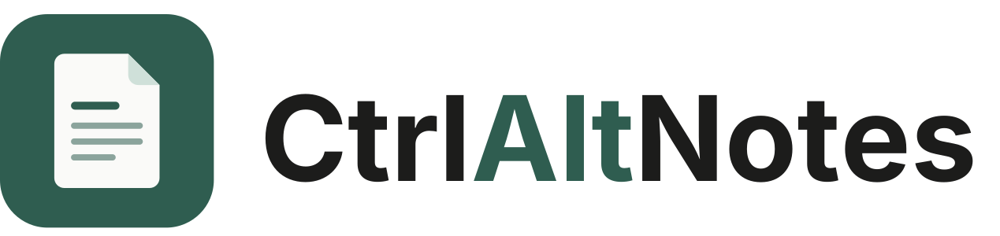
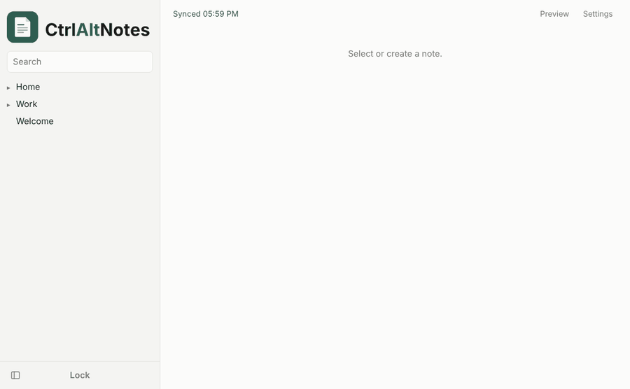

<p align="center">
  <picture>
    <source media="(prefers-color-scheme: dark)" srcset="ui/logo-dark.svg">
    
  </picture>
</p>

<p align="center"><b>Private, end-to-end encrypted Markdown notes for Mac, Windows, Linux and the web.</b><br>
Folders · live preview · automatic encrypted sync · fingerprint and security-key unlock</p>

<p align="center"></p>

> **Status:** version 0.1.0, not independently audited. Read [Verification status](#verification-status) before relying on it.

## Features

- **End-to-end encrypted.** Every note is its own file, encrypted on your device (Argon2id + ChaCha20-Poly1305). Cloud storage only sees ciphertext.
- **Folders and sub-folders**, instant on-device search.
- **Side-by-side live preview**: Markdown on the left, the formatted note on the right; a Preview button shows only the rendered text, and switching live preview off leaves just the editor. Supports tables, task lists, `~~strike~~`, `++underline++`, `==highlight==` and code blocks.
- **Optional formatting toolbar** and shortcuts (Ctrl/Cmd+B, I, U, K). Live preview and toolbar can each be switched on or off in Settings.
- **Dark, light or system theme.** Dark by default; the first option in Settings.
- **Several vaults.** On the desktop unlock screen, *Open a different vault folder…* opens another vault or creates one in an empty folder. Each vault keeps its own sync target and settings.
- **Start where you left off (optional).** Choose in Settings whether the app opens on a blank page or on the note you edited last.
- **Automatic sync, on by default**, through any cloud-synced folder (Proton Drive, iCloud Drive, Dropbox, OneDrive, Syncthing) or a single `.canb` file. The on/off switch and interval live in Settings.
- **Security key or fingerprint unlock** via WebAuthn PRF (YubiKey-style keys, Touch ID, Windows Hello where the window allows it).
- **Export what you choose.** Tick folders and notes. Desktop apps write to a folder you pick; the web version downloads a `.md` or `.zip` to your Downloads folder. Exports are not encrypted.
- **Modern password rules** (NIST SP 800-63B-4: 15+ characters, no composition rules, blocklist and pattern checks) plus a one-time recovery key.
- **Mac, Windows, Linux and web** from one Rust backend and one UI. No account, no telemetry, no servers.

| Create a vault | Folders and search | Settings |
|---|---|---|
|  |  |  |

## Documentation

* **Technical documentation** (architecture, vault format, cryptography, sync, API, security model): [`docs/technical/`](docs/technical/), in this repository so that code and docs change together.
* **User guide and landing page**: the separate `ctrlaltnotes-website` repository. Its build reads `docs/technical/` from this repository and publishes both.
* **Security design notes**: [`docs/security-design.md`](docs/security-design.md). **Reporting a vulnerability**: [`SECURITY.md`](SECURITY.md).

## Quick start

Install Rust from <https://rustup.rs>.

```bash
cargo test                                   # run the tests first
cargo run --release -p ctrlaltnotes-server    # web version: prints a link and opens your browser
```

The web binary is `ctrlaltnotes-web` (`target/release/ctrlaltnotes-web`). Options: `--vault <dir>`, `--sync-folder <dir>`, `--sync-file <file>`, `--port <n>`, `--idle-lock <seconds>`, `--no-open`. The link carries a one-time token after `#`; the page removes it from the address bar.

### Mac app

```bash
xcode-select --install
cargo install tauri-cli --version "^2" --locked
cargo tauri build            # output: target/release/bundle/macos and /dmg
```

Universal build: `rustup target add aarch64-apple-darwin x86_64-apple-darwin && cargo tauri build --target universal-apple-darwin`.
Unsigned builds are blocked by Gatekeeper at first launch: right-click → **Open**, or `xattr -dr com.apple.quarantine /Applications/CtrlAltNotes.app`.

### Windows app (build on Windows)

Install Visual Studio Build Tools (Desktop development with C++) and Rust, then in PowerShell:

```powershell
cargo install tauri-cli --version "^2" --locked
cargo tauri build            # output: target\release\bundle\nsis and \msi
```

Unsigned installers trigger SmartScreen ("More info" → "Run anyway").

### Linux app (build on Linux)

Install the WebKitGTK toolchain, Rust, then build. Debian/Ubuntu (22.04+):

```bash
sudo apt install build-essential curl file pkg-config libssl-dev \
  libwebkit2gtk-4.1-dev libgtk-3-dev libayatana-appindicator3-dev librsvg2-dev libxdo-dev
cargo install tauri-cli --version "^2" --locked
cargo tauri build            # output: target/release/bundle/deb, /rpm and /appimage
```

Fedora: `sudo dnf install gcc pkgconf-pkg-config openssl-devel webkit2gtk4.1-devel gtk3-devel librsvg2-devel libxdo-devel`. Arch: `sudo pacman -S --needed base-devel webkit2gtk-4.1 gtk3 librsvg xdotool openssl`.
The vault lives in `~/.local/share/app.ctrlaltnotes.desktop/` (the web version uses `$XDG_DATA_HOME/ctrlaltnotes/vault`).

More detail: [`docs/technical/11-building.md`](docs/technical/11-building.md).

## Using it

1. **Create the vault in the window.** Choose a password and save the recovery key shown once. Without the password or recovery key nobody, including the developers, can open your notes.
2. **Sync.** The app offers to pick a sync location right after creation. Switch automatic sync off in *Settings → Sync*.
3. **Second computer.** Choose *I already have a vault in my cloud storage*, enter the password, pick the synced folder.
4. **Lock.** Auto-locks after 5 minutes idle by default (selectable from 1 to 120 minutes, or Never), on close and on quit. Ctrl/Cmd+L locks.

## Project layout

```
crates/core/      crypto, vault format, sync, zip export (no UI, no OS APIs)
crates/service/   the command dispatcher every host calls
crates/server/    web host: hardened localhost HTTP server (binary ctrlaltnotes-web)
app/              Tauri 2 app: macOS, Windows, Linux (iOS and Android planned)
ui/               the single front end (HTML/CSS/JS, no framework, no build step)
docs/technical/   technical documentation (published on the website)
docs/             security design, architecture and pentest notes, media
brand/            icon and logo generator
tests/            browser end-to-end and Markdown robustness tests
scripts/check.sh  the release gate (run before every commit)
.github/          CI, Dependabot, issue and PR templates
```

## Verification status

Be aware of what was and was not run:

- Every change goes through the release gate `scripts/check.sh` (rustfmt, `clippy --all-targets -D warnings`, release tests including the RFC known-answer and NFKC tests with the real crypto crates, `cargo audit`, JS syntax). CI (`.github/workflows/ci.yml`) runs it on Linux, macOS and Windows.
- The macOS app is built and used on macOS. The **Windows and Linux bundles have not yet been built on those systems**; CI compiles the desktop crate on both.
- WebAuthn inside the **Mac app window** may be refused by Apple's WebKit; the password still works. The web version supports it.
- Not independently audited. The author's penetration test found 19 issues, most fixed with regression tests; the rest are documented in [known limits](docs/technical/15-known-limits.md).
- No Android or iOS app in this edition.

Full detail: [`docs/security-design.md`](docs/security-design.md).

## License

Copyright (C) 2026 CtrlAltNotes contributors.

CtrlAltNotes is free software under the [GNU Affero General Public License v3.0 only](LICENSE)
(`AGPL-3.0-only`), the same license family as Signal and Standard Notes. You may use, study,
share and modify it; if you distribute a modified version, or let others use it over a network,
you must publish your source code under the same license.

The name and logo are not covered by the license: see [TRADEMARKS.md](TRADEMARKS.md).
