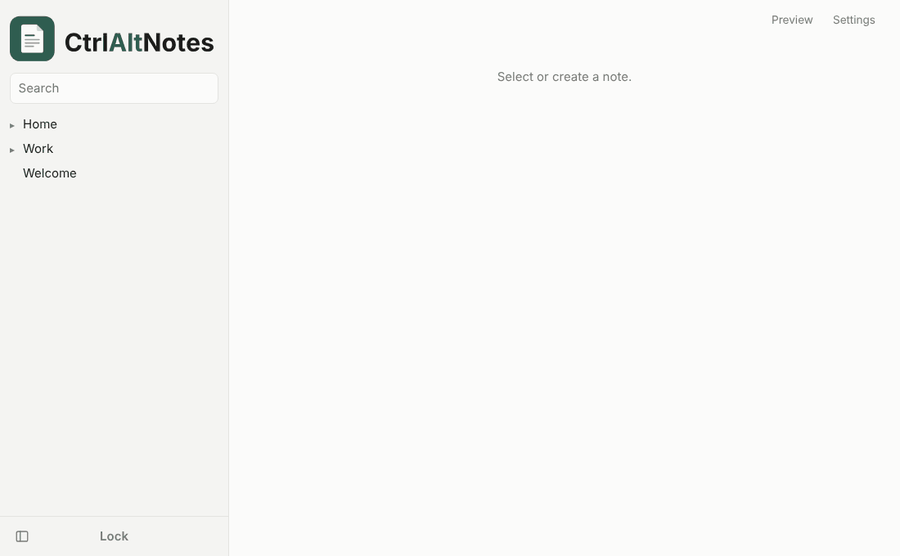
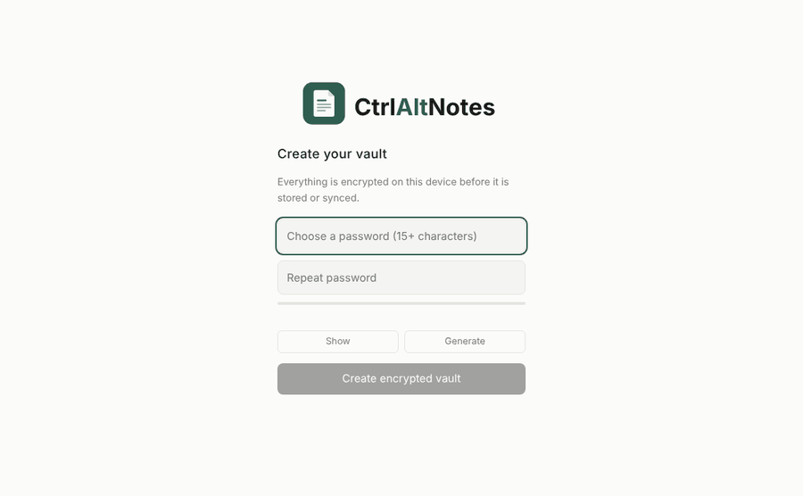

<p align="center">
  <picture>
    <source media="(prefers-color-scheme: dark)" srcset="ui/logo-dark.svg">
    
  </picture>
</p>

<p align="center"><b>Private, end-to-end encrypted Markdown notes for Mac, Windows, Linux and the web.</b><br>
No account. No servers. No tracking. Only you can read your notes.</p>

<p align="center">
  <a href="https://ctrlaltnotes.com">Website</a> ·
  <a href="https://github.com/ctrlaltmg/ctrlaltnotes/releases">Download</a> ·
  <a href="https://ctrlaltnotes.com/docs/">Documentation</a> ·
  <a href="SECURITY.md">Security</a>
</p>

<p align="center">
  <a href="https://github.com/ctrlaltmg/ctrlaltnotes/actions/workflows/ci.yml"></a>
</p>

<p align="center"></p>

> **Alpha (0.1.0-alpha.1).** Good for trying out, not yet for notes you cannot afford to lose; keep a copy of anything important. Not independently audited yet; see [Security](#security).

## Why CtrlAltNotes

- **Your notes are encrypted before they leave the app.** Each note is its own encrypted file (ChaCha20-Poly1305, key from your password with Argon2id). Your cloud provider stores only ciphertext: no titles, no text, no folder names.
- **Sync without an account.** Use any folder your cloud already syncs (Proton Drive, iCloud Drive, Dropbox, OneDrive, Syncthing) or a single file. There is no CtrlAltNotes server.
- **Open source, AGPL-3.0.** Every line can be read and audited, and every release is built from this repository by GitHub with checksums and build provenance.

## Features

- **Markdown with live preview**: Markdown on the left, the formatted note on the right; tables, task lists, `==highlight==`, `++underline++`, `~~strike~~`, code blocks. Optional formatting toolbar.
- **Folders and sub-folders**, drag and drop, instant search on your device.
- **Automatic encrypted sync**, on by default, with an on/off switch and interval in Settings.
- **Unlock with a password, the recovery key, or a security key / fingerprint** (WebAuthn PRF: YubiKey, Touch ID, Windows Hello where the window allows it).
- **Several vaults**: open a different vault folder from the unlock screen; each keeps its own sync location and settings.
- **Dark, light or system theme** (dark by default).
- **Auto-lock** after inactivity (1 to 120 minutes, or never), on close and on quit.
- **Selective export** of folders and notes to plain Markdown (exports are not encrypted).
- **Modern password rules** (NIST SP 800-63B-4: 15+ characters, no composition rules, common and patterned passwords refused) and a one-time recovery key.

| Create a vault | Folders and search | Settings |
|---|---|---|
|  |  |  |

## Download and install

Download from the [releases page](https://github.com/ctrlaltmg/ctrlaltnotes/releases):

| System | File |
|---|---|
| macOS 11+ (Apple silicon and Intel) | `CtrlAltNotes_…_universal.dmg` |
| Windows 10 / 11 | `CtrlAltNotes_…_x64-setup.exe` |
| Linux | `.deb` (Debian, Ubuntu), `.rpm` (Fedora), `.AppImage` (any distribution) |
| Web version (runs only on your computer) | `ctrlaltnotes-web-…` |

**Verify before installing.** The alpha is not code-signed yet, so macOS and Windows will warn. Check that your download is exactly what GitHub built from this source. Download `SHA256SUMS` from the same release, then:

```bash
shasum -a 256 -c SHA256SUMS --ignore-missing     # macOS / Linux: the file must report OK
```

On Windows: `Get-FileHash <file> -Algorithm SHA256` and compare with `SHA256SUMS`. Every file also has a signed [build-provenance attestation](https://github.com/ctrlaltmg/ctrlaltnotes/attestations).

Step-by-step installation, including the first-launch warnings: **[Install and open](https://ctrlaltnotes.com/docs/guide/install-and-open)**.

## Using it

1. **Create your vault.** Choose a password of 15+ characters and save the recovery key shown once. Without the password or the recovery key nobody, including the developers, can open your notes.
2. **Choose a sync location** (optional). Pick a folder your cloud service syncs; notes then sync automatically, always encrypted.
3. **Add another computer.** Install the app, choose *I already have a vault in my cloud storage*, enter the password and pick the same folder.
4. **Lock** with `Ctrl`/`Cmd` + `L`. The app also locks itself when idle, when the window closes and on quit.

Shortcuts: `Ctrl`/`Cmd` + `B` sidebar, `E` preview, `L` lock. The full **[user guide](https://ctrlaltnotes.com/docs/guide/start-here)** covers writing, sync, security keys, export and settings.

## Documentation

| | |
|---|---|
| User guide | [ctrlaltnotes.com/docs/guide](https://ctrlaltnotes.com/docs/guide/start-here) |
| Technical documentation (architecture, vault format, cryptography, sync, API) | [`docs/technical/`](docs/technical/) · [online](https://ctrlaltnotes.com/docs/technical/overview) |
| Build from source | [`docs/technical/11-building.md`](docs/technical/11-building.md) |
| Contributing and development setup | [`CONTRIBUTING.md`](CONTRIBUTING.md) |
| Changelog | [`docs/technical/18-changelog.md`](docs/technical/18-changelog.md) |

## Security

- **Report a vulnerability privately**: [Security → Report a vulnerability](https://github.com/ctrlaltmg/ctrlaltnotes/security/advisories/new). Please do not open public issues for security problems. Policy and response times: [`SECURITY.md`](SECURITY.md).
- **How it is protected**: [security model](docs/technical/13-security-model.md), [cryptography](docs/technical/03-cryptography.md), [hardening checklist](docs/technical/19-hardening.md).
- **Honest status**: built on audited RustCrypto libraries and tested on every change (formatting, lints, tests including RFC known-answer tests, dependency advisories and licenses, secret scanning), and penetration-tested by the author ([report](docs/technical/14-pentest-report.md)). It has **not** had an independent audit yet. Known limits: [`docs/technical/15-known-limits.md`](docs/technical/15-known-limits.md).

## Contributing

Bug reports, reproductions and documentation feedback are welcome as [issues](https://github.com/ctrlaltmg/ctrlaltnotes/issues). Code contributions will need a Contributor License Agreement (because the apps are also distributed through app stores); see [`CONTRIBUTING.md`](CONTRIBUTING.md). Everyone is expected to follow the [code of conduct](CODE_OF_CONDUCT.md).

## License

Copyright (C) 2026 CtrlAltNotes contributors.

CtrlAltNotes is free software under the [GNU Affero General Public License v3.0 only](LICENSE) (`AGPL-3.0-only`), the same license family as Signal and Standard Notes. You may use, study, share and modify it; if you distribute a modified version, or let others use it over a network, you must publish its source code under the same license.

The name and logo are not covered by the license: see [`TRADEMARKS.md`](TRADEMARKS.md).
